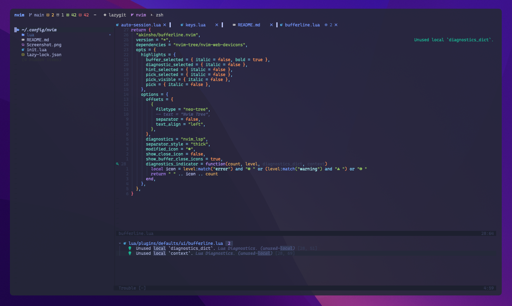

# nvim-config



My Neovim configuration, focused on **reading and navigating code** rather than writing it:
native LSP, Treesitter, a fast picker and a light autocompletion.

## Requirements

- Neovim **0.12+**
- `git`, a C compiler and the [`tree-sitter` CLI](https://github.com/tree-sitter/tree-sitter) (parsers compilation)
- [`ripgrep`](https://github.com/BurntSushi/ripgrep) and [`fd`](https://github.com/sharkdp/fd) (picker)
- [`yazi`](https://github.com/sxyazi/yazi) (file manager)
- A [Nerd Font](https://www.nerdfonts.com/)

```sh
brew install neovim tree-sitter-cli ripgrep fd yazi
git clone https://github.com/TayzenDev/nvim-config ~/.config/nvim
```

Language servers and formatters are installed with `:Mason`. Every installed server is enabled automatically.

## Structure

```text
init.lua
lua/config/          options, keymaps, lazy.nvim bootstrap
lua/plugins/         one file per plugin, grouped by category
  snacks.lua         picker, notifier, indent guides, word highlighting, git browse
  ui/                colorscheme, statusline, bufferline, noice, which-key, ...
  navigation/        neo-tree, yazi, flash, harpoon, tmux, sessions
  lsp/               mason + native LSP, lazydev, inc-rename, venv-selector
  coding/            treesitter, blink.cmp, conform, mini.pairs, todo-comments
  git/               gitsigns, fugitive, diffview, octo
```

Per-server LSP overrides can be added in a top-level `lsp/<server>.lua` file (see `:help lsp-config`).

## Plugins

- [`lazy.nvim`](https://github.com/folke/lazy.nvim): plugin manager
- [`snacks.nvim`](https://github.com/folke/snacks.nvim): picker, notifier, indent guides, word highlighting, git browse
- [`tokyonight.nvim`](https://github.com/folke/tokyonight.nvim): colorscheme (transparent)
- [`lualine.nvim`](https://github.com/nvim-lualine/lualine.nvim): status line
- [`bufferline.nvim`](https://github.com/akinsho/bufferline.nvim): buffers as tabs
- [`noice.nvim`](https://github.com/folke/noice.nvim): cmdline and messages UI
- [`which-key.nvim`](https://github.com/folke/which-key.nvim): show keybindings while typing
- [`trouble.nvim`](https://github.com/folke/trouble.nvim): diagnostics list
- [`rainbow-delimiters.nvim`](https://github.com/HiPhish/rainbow-delimiters.nvim): rainbow parentheses
- [`nvim-treesitter-context`](https://github.com/nvim-treesitter/nvim-treesitter-context): sticky function / class header
- [`neo-tree.nvim`](https://github.com/nvim-neo-tree/neo-tree.nvim): file tree
- [`yazi.nvim`](https://github.com/mikavilpas/yazi.nvim): yazi integration
- [`flash.nvim`](https://github.com/folke/flash.nvim): jump anywhere with 2 letters
- [`harpoon`](https://github.com/ThePrimeagen/harpoon/tree/harpoon2): file bookmarks
- [`vim-tmux-navigator`](https://github.com/christoomey/vim-tmux-navigator): tmux integration
- [`auto-session`](https://github.com/rmagatti/auto-session): automatic sessions
- [`mason.nvim`](https://github.com/mason-org/mason.nvim) + [`mason-lspconfig.nvim`](https://github.com/mason-org/mason-lspconfig.nvim) + [`nvim-lspconfig`](https://github.com/neovim/nvim-lspconfig): LSP servers
- [`lazydev.nvim`](https://github.com/folke/lazydev.nvim): Neovim API for `lua_ls`
- [`inc-rename.nvim`](https://github.com/smjonas/inc-rename.nvim): rename with preview
- [`venv-selector.nvim`](https://github.com/linux-cultist/venv-selector.nvim): Python virtualenvs
- [`nvim-treesitter`](https://github.com/nvim-treesitter/nvim-treesitter) (`main` branch): parsers
- [`blink.cmp`](https://github.com/saghen/blink.cmp): minimal autocompletion
- [`conform.nvim`](https://github.com/stevearc/conform.nvim): format on save
- [`mini.pairs`](https://github.com/nvim-mini/mini.pairs): autopairs
- [`todo-comments.nvim`](https://github.com/folke/todo-comments.nvim): highlight TODO comments
- [`gitsigns.nvim`](https://github.com/lewis6991/gitsigns.nvim): git signs and blame
- [`vim-fugitive`](https://github.com/tpope/vim-fugitive): git commands
- [`diffview.nvim`](https://github.com/sindrets/diffview.nvim): side by side diffs, file history
- [`octo.nvim`](https://github.com/pwntester/octo.nvim): GitHub PR reviews (`:Octo <PR url>`, then `:Octo review`)

Built-in Neovim features replace a few former plugins: commenting (`gc`), LSP keymaps (`:help lsp-defaults`),
diagnostics under the current line (`virtual_lines`).
